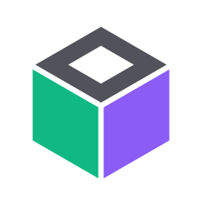

<div align="center">
  
  <h1>Lifevuww v2.0</h1>
  <p><strong>Gamified Habit Tracker & RPG Productivity Platform</strong></p>

  <p>
    <a href="https://github.com/fahmimaulanairsyad/Lifevuww/actions/workflows/ci.yml">
      
    </a>
    
    
    
    
    
  </p>
</div>

---

## 📖 Ringkasan Proyek

**Lifevuww v2.0** adalah platform pelacak rutinitas (habit tracker) modern berbasis web yang mengubah produktivitas dan disiplin harian menjadi sebuah petualangan **RPG (Role Playing Game)**. 

Setiap kebiasaan positif yang Anda selesaikan memberikan **Experience Points (EXP)** untuk menaikkan level dan rank karakter serta mata uang **Gold** untuk menebus reward di Toko Hadiah. Sebaliknya, kelalaian tugas memiliki konsekuensi nyata berupa pengurangan **Health Points (HP)** hingga kematian karakter (*Game Over / EXP Penalty*).

---

## ✨ Fitur Unggulan Lifevuww v2.0

### 1. 🌌 Obsidian Glass UI Maxing & Spatial Shell
* **Top Telemetry Cockpit HUD**: Panel status kompak di bagian atas layar (`HP`, `Level`, `EXP`, `Gold`) dengan indikator waktu nyata dan akses cepat Command Palette serta audio.
* **Expanding Active Pill Floating Dock**: Bilah navigasi melayang 7 item di bagian bawah layar. Pada tampilan HP (< 768px), label teks pada item non-aktif disembunyikan otomatis dan hanya melebar pada item yang sedang aktif, sehingga sangat ergonomis untuk jempol.
* **Top Vignette Shield**: Efek pelindung gradasi atas halus yang mencegah benturan visual saat konten digulir ke atas.

### 2. ⚡ Multi-Count Habit Stepper `[ - ] 1/3 [ + ]`
* Mendukung rutinitas yang perlu dilakukan berulang kali dalam satu siklus (contoh: *Minum 3 Botol Air*, *Sikat Gigi 2x Sehari*, atau *Workout 3x Seminggu*) tanpa perlu membuat kartu duplikat.
* Menampilkan kontrol stepper elegan dengan tombol `[ - ]` dan `[ + ]`, display hitungan tabular, serta mini progress bar.
* Progres disimpan instan via AJAX: klaim hadiah EXP & Gold hanya diberikan saat target terpenuhi penuh, dan dapat dibatalkan kembali secara aman.

### 3. 🗓️ Flexible Recurrence Schedules (Jadwal Fleksibel)
* Mendukung berbagai pola perulangan rutinitas:
  * **Setiap Hari** (*Daily*)
  * **Tiap N Hari Sekali** (*Interval Days*, misal tiap 2 atau 3 hari sekali)
  * **Hari Tertentu dalam Seminggu** (*Weekly Days*, misal Senin, Rabu, Jumat)
  * **Tiap N Minggu Sekali** (*Interval Weeks*)
  * **Tiap N Bulan Sekali** (*Interval Months*)
* Dilengkapi algoritma evaluasi otomatis (`isHabitDueToday`): penalti HP dan pemutusan streak saat daily reset hanya dikenakan pada rutinitas yang memang jatuh tempo pada hari tersebut.

### 4. 🐉 Boss Quests dengan Sub-Checklist & Dynamic HP Bar
* Misi bertingkat sulit (Hard) atau misi dengan sub-langkah otomatis berubah menjadi **Boss Quest** dengan hadiah 1.5x EXP & Gold.
* Dilengkapi bar HP Boss dan checklist fase bertahap:
  * Mencengang fase memicu serangan: teks melayang merah `⚔️ -[X]% HP Boss` dan getaran kartu.
  * Melepas centang memicu pemulihan: teks melayang amber `↺ +[X]% HP Boss Pulih` tanpa getar layar.
* Misi baru dapat diselesaikan setelah seluruh pertahanan Boss dihancurkan (HP Boss 0%).

### 5. 🏆 8 Holographic Achievement Badges (3D Tilt Effect)
* Koleksi 8 lencana pencapaian karakter dengan efek visual 3D Holographic Tilt:
  * 👟 **Langkah Pertama** (Aktivitas perdana)
  * 🔥 **Penjaga Api** (Streak 7 hari)
  * 🛡️ **Disiplin Baja** (Streak 30 hari)
  * 🪙 **Saudagar Emas** (Saldo 200 Gold)
  * ⚡ **Kebangkitan Karakter** (Mencapai Level 5)
  * ❄️ **Perisai Abadi** (100 HP + Perisai Freeze)
  * 📜 **Penakluk Misi** (5 Quest tuntas)
  * 👑 **Kedaulatan Disiplin** (50 Akumulasi tugas)
* Pada layar HP (< 640px), etalase otomatis tertata dalam format 2 kolom padat (2x4) yang rapi.

### 6. 🔍 Linear-Style Command Palette (`Ctrl+K` / `⌘K`)
* Akses menu cepat dan navigasi instan hanya dengan menekan pintasan keyboard `Ctrl + K` (Windows/Linux) atau `⌘K` (Mac).
* Prioritas z-index tertinggi (10090) dengan pencarian otomatis berfokus langsung pada input, mendukung navigasi seluruh modul dan aksi cepat pembuatan tugas.

### 7. 📅 60-Day Interactive Consistency Heatmap
* Matriks 60 hari visualisasi keteraturan disiplin bergaya GitHub.
* **Tap-to-Filter**: Klik atau sentuh kotak tanggal tertentu pada heatmap untuk menyaring daftar log aktivitas di bawahnya secara langsung, lengkap dengan custom floating tooltip dan tombol reset filter.

### 8. 💾 JSON & CSV Backup & Restore Engine
* Ekspor seluruh data akun (profil, kebiasaan, misi, riwayat log, dan transaksi reward) dalam format **JSON** utuh atau **CSV** tabel.
* Fitur restore data dari file JSON cadangan untuk kemudahan migrasi antar perangkat.

### 9. 🎬 15s & 30s High-Octane Kinetic Motion Reel
* Showcase animasi bertempo tinggi 120 BPM yang dibangun 100% dari kode native HTML5, CSS Keyframes, dan Web Audio Synthesizer prosedural tanpa beban file video berat.
* Dilengkapi kontrol player di topbar (Switcher durasi 15s/30s, Instant Replay via `postMessage`, Mode Layar Penuh 1920x1080 dengan fallback CSS untuk APK/iOS), timeline progress bar, serta auto-pause saat di luar viewport layar.

---

## 🎮 Mekanisme Inti Game RPG

### 1. ⚔️ Rumus Karakter & Hierarki Gelar (Rank)
* **Rumus Level:** `Level = floor(EXP / 100) + 1`
* **7 Tingkatan Gelar (Rank Tiers):**
  * Level 30+: **S-Rank Sovereign**
  * Level 22+: **A-Rank Master**
  * Level 15+: **B-Rank Elite**
  * Level 10+: **C-Rank Vanguard**
  * Level 6+: **D-Rank Explorer**
  * Level 3+: **E-Rank Rookie**
  * Level 1-2: **F-Rank Novice**

### 2. ❤️ Sistem Nyawa (HP) & Penalti Kegagalan
* Pengguna memiliki **100 Max HP**.
* Mengabaikan kebiasaan yang jatuh tempo atau membiarkan misi kedaluwarsa akan memotong HP sesuai tingkat kesulitan (*Easy: -5 HP, Medium: -10 HP, Hard: -15 HP*).
* **Game Over (HP = 0):** Karakter kehilangan **50% total EXP**, seluruh streak diputus, dan nyawa dipulihkan kembali ke 100 HP.

### 3. 🔥 Multiplier Streak
* Menjaga konsistensi berturut-turut membangun pengganda hadiah:
  * **Streak 3-6 Hari:** Bonus **1.2x Multiplier** untuk EXP & Gold.
  * **Streak 7+ Hari:** Bonus **1.5x Multiplier** untuk EXP & Gold.

### 4. 🪙 Toko Hadiah & Ekonomi Virtual
* Dapatkan saldo Gold dari setiap penyelesaian Habit dan Quest.
* **Item Sistem:**
  * 🧪 **Minor Health Potion (25 Gold):** Memulihkan +25 HP.
  * ⚗️ **Full Elixir of Life (75 Gold):** Memulihkan 100 HP penuh.
  * 🧊 **Streak Freeze Shield (50 Gold):** Melindungi streak dan HP dari 1 hari absen.
* **Hadiah Pribadi:** Tambahkan hadiah dunia nyata buatan Anda sendiri (misal: *Main Game 2 Jam*, *Beli Kopi*, dll).

---

## 🛠️ Tech Stack & Arsitektur

* **Backend:** PHP 8.1+ (Native OOP/Procedural, PDO dengan Prepared Statements)
* **Database:** MySQL / MariaDB (Skema relasional ternormalisasi dengan runner migrasi otomatis)
* **Frontend:** Vanilla CSS Modern (Custom Design System Obsidian Glass), Bootstrap 5 Grid Utilities, FontAwesome 6, Chart.js, GSAP ScrollTrigger
* **Audio:** Web Audio API Procedural Synthesizer (Zero-audio file footprint)
* **Keamanan:** Proteksi Token CSRF pada seluruh mutasi POST, Password Hashing via `password_verify()`, Sanitasi XSS, Proteksi Brute-force Login Attempts, Header Content Security Policy (CSP).

---

## 🚀 Panduan Instalasi Cepat

### Prasyarat
* Web server lokal (XAMPP, Laragon, atau Docker) dengan PHP 8.1+ dan MySQL.

### Langkah Setup
1. **Clone repositori:**
   ```bash
   git clone https://github.com/fahmimaulanairsyad/Lifevuww.git
   ```
2. **Pindahkan ke direktori web server:**
   * XAMPP: `C:\xampp\htdocs\Lifevuww`
   * Laragon: `C:\laragon\www\Lifevuww`
3. **Konfigurasi Lingkungan (`.env`):**
   * Salin file `.env.example` menjadi `.env` lalu sesuaikan kredensial database:
     ```env
     DB_HOST=localhost
     DB_NAME=habit_tracker_rpg
     DB_USERNAME=root
     DB_PASSWORD=
     ```
4. **Setup Database:**
   * Import file `database.sql` ke database Anda melalui phpMyAdmin atau MySQL CLI.
   * Jalankan runner migrasi otomatis:
     ```bash
     php migrate.php
     ```
5. **Menjalankan Pengujian Unit Test:**
   ```bash
   php tests/run_tests.php
   ```

---

## 📜 Lisensi
Didistribusikan di bawah lisensi MIT. Dibuat dengan dedikasi untuk produktivitas gamifikasi oleh **Fahmi Maulana Irsyad**.
